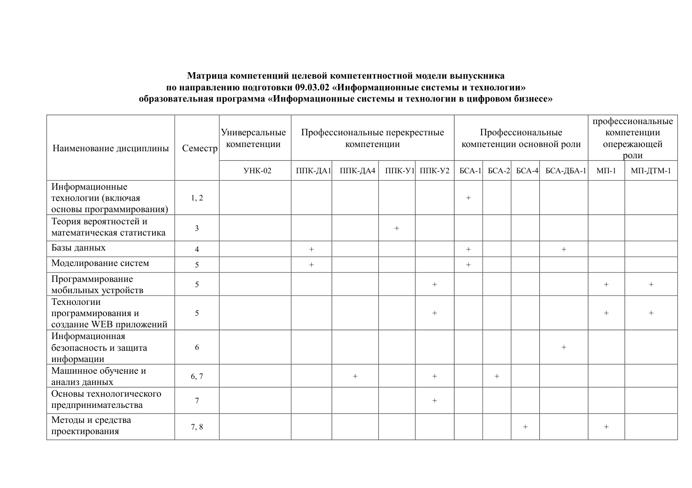
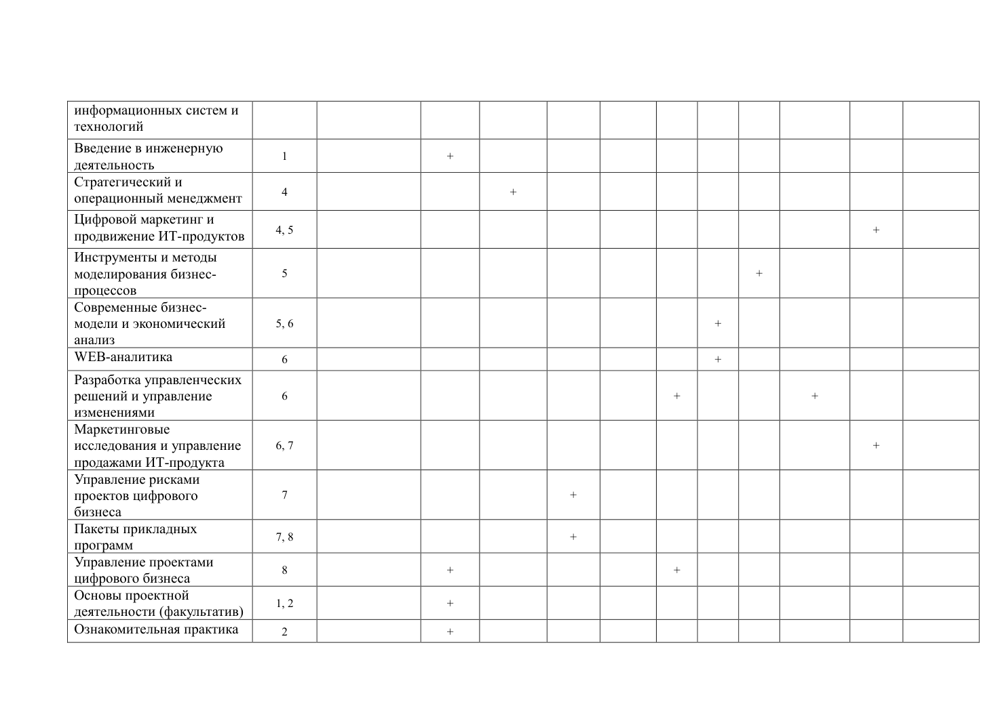
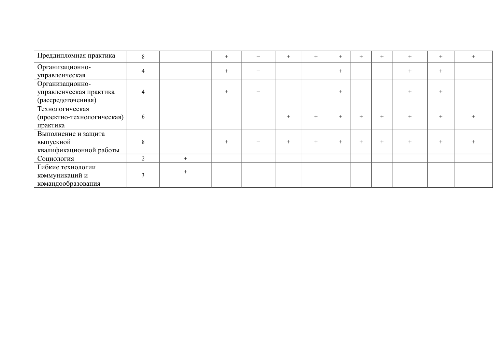

# 5_Матрица компетенций_ЦКМВ_09.03.02_ИСТ_ЦБ

> Источник: PDF, 3 стр. Текст конвертирован без редакционного изменения содержания. Для сложных таблиц приложены изображения страниц.

## Страница 1



```text
Матрица компетенций целевой компетентностной модели выпускника
                      по направлению подготовки 09.03.02 «Информационные системы и технологии»
                  образовательная программа «Информационные системы и технологии в цифровом бизнесе»

                                                                                                            профессиональные
                                  Универсальные   Профессиональные перекрестные       Профессиональные         компетенции
                                   компетенции             компетенции            компетенции основной роли    опережающейНаименование дисциплины   Семестр
                                                                                                                   роли

                                         УНК-02     ППК-ДА1  ППК-ДА4  ППК-У1 ППК-У2  БСА-1 БСА-2 БСА-4 БСА-ДБА-1  МП-1   МП-ДТМ-1

Информационные
технологии (включая                1, 2                                                         +
основы программирования)
Теория вероятностей и
                                   3                                          +математическая статистика
Базы данных                      4                        +                                 +                    +
Моделирование систем           5                        +                                 +
Программирование
                                   5                                                   +                                    +         +
мобильных устройств
Технологии
программирования и              5                                                   +                                    +         +
создание WEB приложений
Информационная
безопасность и защита            6                                                                               +
информации
Машинное обучение и
                                             6, 7                                +                +            +
анализ данных
Основы технологического
                                   7                                                   +предпринимательства
Методы и средства
                                             7, 8                                                                     +                 +проектирования
```

## Страница 2



```text
информационных систем и
технологий
Введение в инженерную
                                   1                        +
деятельность
Стратегический и
                                   4                                 +операционный менеджмент
Цифровой маркетинг и
                                             4, 5                                                                                       +продвижение ИТ-продуктов
Инструменты и методы
моделирования бизнес-           5                                                                      +
процессов
Современные бизнес-
модели и экономический           5, 6                                                               +
анализ
WEB-аналитика                  6                                                                +
Разработка управленческих
решений и управление            6                                                          +                    +
изменениями
Маркетинговые
исследования и управление        6, 7                                                                                       +
продажами ИТ-продукта
Управление рисками
проектов цифрового              7                                          +
бизнеса
Пакеты прикладных
                                             7, 8                                         +
программ
Управление проектами
                                   8                        +                                 +
цифрового бизнеса
Основы проектной
                                             1, 2                       +
деятельности (факультатив)
Ознакомительная практика       2                        +
```

## Страница 3



```text
Преддипломная практика         8                        +        +        +       +      +     +     +       +        +         +
Организационно-
                                   4                        +        +                        +                    +        +
управленческая
Организационно-
управленческая практика         4                        +        +                        +                    +        +
(рассредоточенная)
Технологическая
(проектно-технологическая)      6                                          +       +      +     +     +       +        +         +
практика
Выполнение и защита
выпускной                        8                        +        +        +       +      +     +     +       +        +         +
квалификационной работы
Социология                       2            +
Гибкие технологии
                                            +
коммуникаций и                  3
командообразования
```
